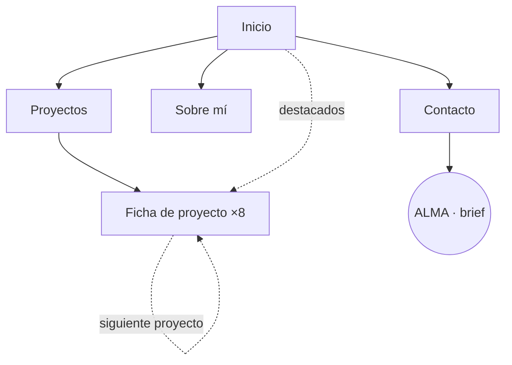

# Sitemap y arquitectura de información

## Objetivos del sitio
1. **Presentar mi identidad** como diseñadora crossmedia y directora de arte en los primeros segundos (Inicio).
2. **Mostrar el trabajo con contexto**: cada proyecto con concepto, proceso y resultado (Proyectos y Ficha).
3. **Generar confianza** contando quién soy, cómo trabajo y qué me mueve (Sobre mí).
4. **Convertir visitas en conversaciones**: llevar a quien tiene un proyecto al brief en **ALMA** y dar un canal directo para lo rápido (Contacto).

## Sitemap jerárquico

```
Inicio (index.html)
├── Proyectos (proyectos.html)
│   └── Ficha de proyecto (proyecto.html#slug) × 8
│       Bloom Store · Danny Road · Tradición en Canasta · Velvet Club ·
│       Museos de Pereira · Media kit · Piezas culturales · Marca personal
├── Sobre mí (sobre-mi.html)
└── Contacto (contacto.html) ──→ ALMA (app de brief, enlace externo)

Páginas de soporte: 404.html · design-system.html (guía del sistema, enlazada en el footer)
```



## Navegación
- **Menú principal** (todas las páginas): Inicio · Proyectos · Sobre mí · Contacto, más el botón **Trabajemos** (a Contacto) y el contador de estrellas. La página actual se marca con `aria-current="page"`.
- **Móvil:** el menú se abre a pantalla completa con el botón hamburguesa y se cierra con Escape.
- **Footer** (todas las páginas): llamado a la acción, enlaces de navegación y redes, y enlace al Design System.
- **Navegación contextual:** carpetas de servicios → Proyectos; fotografías de la mesa → Ficha; «Siguiente proyecto» al final de cada ficha; «← Todos los proyectos» al inicio; botones a Contacto y a ALMA al cierre de las páginas.
- **Rutas:** cada ficha tiene su propia dirección con `#slug` (por ejemplo `proyecto.html#danny-road`), así se puede compartir el enlace de un proyecto.

## Organización de contenidos por página

### Inicio
Presentación y puerta de entrada.
1. Hero: método *Habito · Conceptualizo · Materializo*, presentación, botones y datos; collage arrastrable con foto, lema, sello y flor.
2. Mis expedientes: los cuatro servicios en carpetas (Dirección de arte, Identidad visual, Diseño editorial, Foto y audiovisual).
3. Proyectos sobre la mesa: cuatro proyectos recientes como fotos arrastrables.
4. ¿Te suena alguna de estas pistas?: los problemas del público objetivo en notas en movimiento.
5. Mi manifiesto: seis ideas en barras que entran una por una.
6. Cierre: invitación a escribir o a llenar el brief en ALMA.

### Proyectos
Archivo de trabajos con filtros por categoría (Dirección de arte, Identidad, Editorial, Redes, Audiovisual, Fotografía, Web/UI) y dos vistas: **Mesa** (fotos sueltas que se arrastran) y **Lista** (cuadrícula ordenada).

### Ficha de proyecto (plantilla)
Una sola plantilla que se llena desde `js/datos.js`: título, cliente, resumen y ficha técnica; portada con lupa; 01 Concepto con paleta; 02 Proceso en cuatro pasos; 03 Antes / después; 04 Resultado; galería (incluye reels en celular) y siguiente proyecto.

### Sobre mí
Quién soy y cómo trabajo: presentación con foto; arquetipos en breve; el proceso en tres pasos; lo que pasa detrás (fotos de procesos que se arrastran); habilidades y herramientas; cierre.

### Contacto
Dos caminos: **¿Tienes un proyecto?** → ALMA, la app de brief; **¿Es algo rápido?** → postales de WhatsApp, correo, Instagram y TikTok (Behance se suma cuando esté el enlace). Cierra con preguntas frecuentes.

## Justificación de la estructura
La guía pide Home + dos internas; este sitio tiene Home + cuatro internas porque el portafolio necesita separar **ver el trabajo** (Proyectos → Ficha) de **conocer a la persona** (Sobre mí) y de **empezar un proyecto** (Contacto). La Ficha es una plantilla reutilizable, lo que permite sumar proyectos en el Momento 3 solo agregando datos.
